# Plyst

> 복사한 텍스트와 이미지를 한 곳에 모아 정리하고 다시 꺼내 쓰는 UIKit 기반 클립보드 보관 앱<br>
> 앱 안에서 복사한 내용뿐 아니라 위젯과 공유 시트로 들어온 내용도 하나의 클립 기록으로 관리하는 구조

<a href="https://github.com/opficdev/Plyst_RN"></a>

<a href="https://apps.apple.com/kr/app/plyst/id6818818750"></a>

<table>
  <tr>
    <td width="33%" align="center"><b>Home</b></td>
    <td width="33%" align="center"><b>Search</b></td>
    <td width="33%" align="center"><b>텍스트 상세</b></td>
  </tr>
  <tr>
    <td width="33%">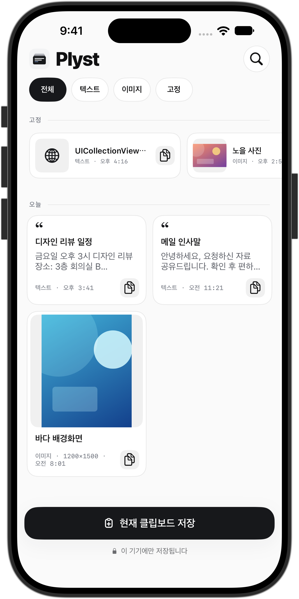</td>
    <td width="33%">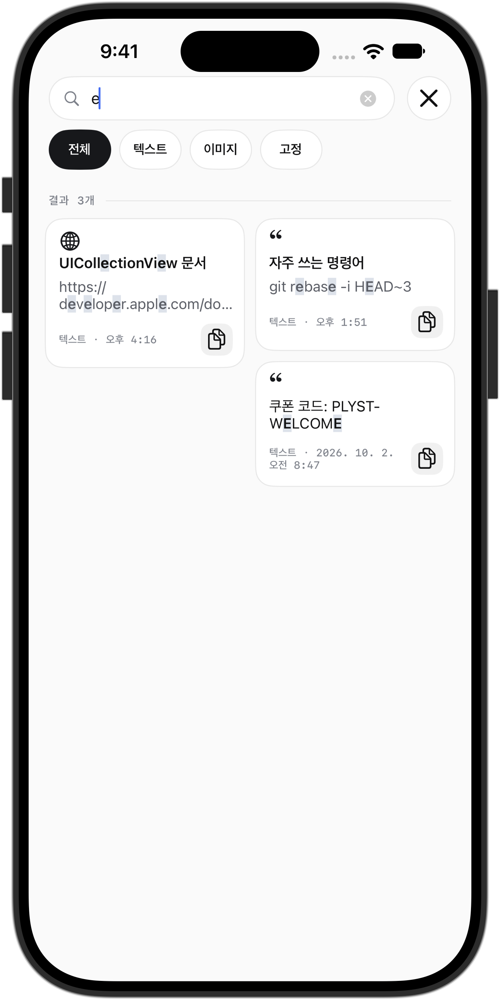</td>
    <td width="33%">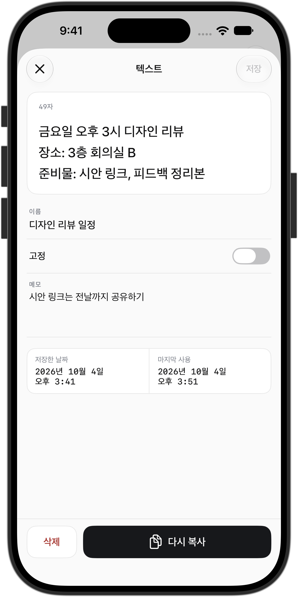</td>
  </tr>
  <tr>
    <td width="33%" align="center"><b>이미지 상세</b></td>
    <td width="33%" align="center"><b>Widget</b></td>
    <td width="33%" align="center"><b>공유</b></td>
  </tr>
  <tr>
    <td width="33%">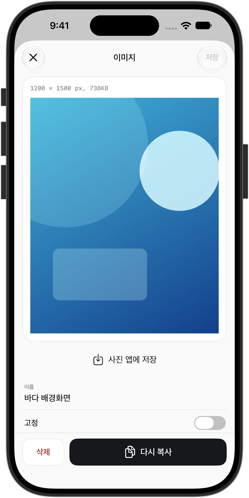</td>
    <td width="33%">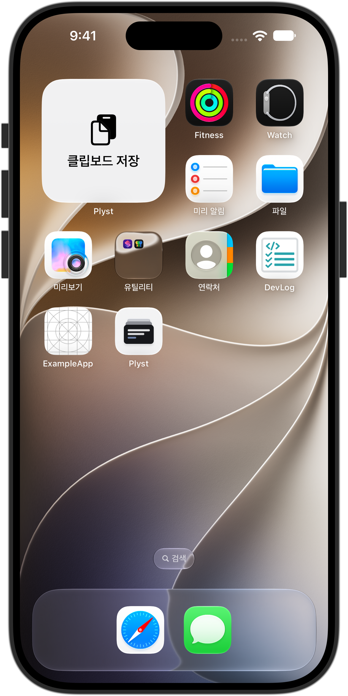</td>
    <td width="33%">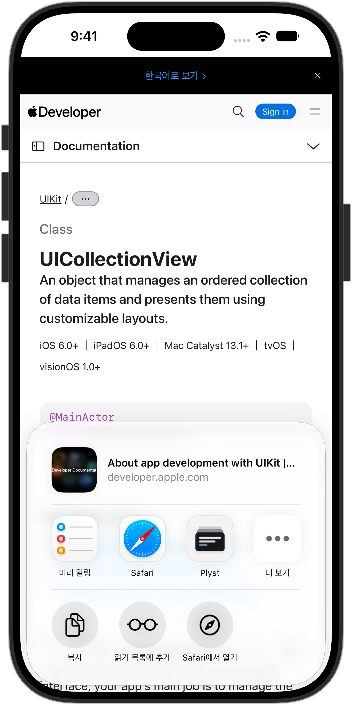</td>
  </tr>
</table>

## 주요 기능

- 클립을 전체, 텍스트, 이미지, 고정 필터로 분류하고 고정 클립을 별도 영역에 표시
- 현재 클립보드를 저장하고 결과를 토스트로 안내
- 클립을 복사, 삭제하고 길게 눌러 고정, 고정 해제, 삭제 메뉴 표시
- 이미지 썸네일을 비동기로 불러와 캐시
- 텍스트의 이름과 본문, 이미지의 이름과 저장 시각에서 대소문자 구분 없이 검색하고 일치하는 부분을 강조
- 최근 검색어를 선택, 개별 삭제, 전체 삭제하고 검색 결과를 필터로 좁혀 복사
- 텍스트 상세에서 이름, 메모, 고정 여부를 편집하고 저장, 복사, 삭제 (저장 시각과 마지막 사용 시각 표시)
- 이미지 상세에서 이름과 고정 여부를 편집하고 저장, 복사, 삭제 (사진 앱에 저장)
- 위젯을 탭하면 앱을 열고 클립보드 내용을 클립으로 저장
- 공유 시트에서 텍스트, 웹 URL, 이미지를 클립으로 저장 (Safari 이미지는 이미지 URL에서 내려받아 저장)
- 공유 저장에 실패하면 다시 시도하거나 취소

## 핵심 성과

### **1. 축소 디코딩으로 이미지 리스트 스크롤 메모리 1,179MiB → 76.5MiB 감소**

<table>
  <tr>
    <td align="center"><b>원본 디코딩 (대조 빌드)</b></td>
  </tr>
  <tr>
    <td>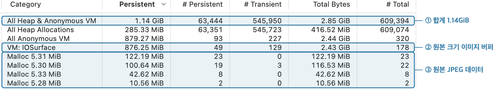</td>
  </tr>
  <tr>
    <td align="center"><b>축소 디코딩</b></td>
  </tr>
  <tr>
    <td>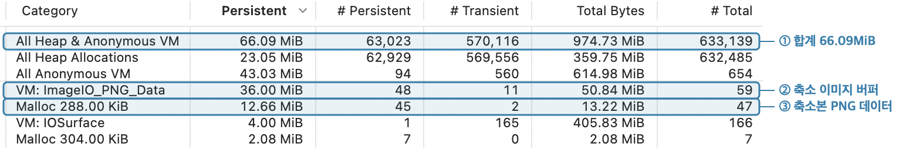</td>
  </tr>
</table>

> **문제**<br>
> 리스트가 원본 크기로 디코딩한 이미지와 원본 JPEG 데이터를 48장까지 보관하면 스크롤만으로 메모리가 1GiB를 넘음
>
> **해결**<br>
> 원본은 디스크에 두고 표시 크기에 맞춘 ImageIO 축소본만 디코딩<br>
> 메모리 캐시에는 축소본만 보관해 48장을 채워도 수십 MiB 안에서 유지
>
> **성과**<br>
> ✅ 리스트 스크롤 (이미지 50장 리스트를 맨 아래까지 2회 왕복) 메모리 피크 **1,179MiB → 76.5MiB**<br>
> ✅ 앱 시작 직후 메모리 **112.8MiB → 23.3MiB**<br>
> ✅ 원본은 **재인코딩 없이 보존**해 화질 유지<br>
> ⚠️ 이미지 한 장만 표시하는 상세 화면은 **차이 없음** (+29.4MiB → +28.8MiB)<br>
> ⚠️ 비교 대상은 이전 버전이 아닌 **원본 디코딩 대조 빌드**

```swift
let thumbnailOptions = [
    kCGImageSourceCreateThumbnailFromImageAlways: true,
    kCGImageSourceCreateThumbnailWithTransform: true,
    kCGImageSourceShouldCacheImmediately: true,
    kCGImageSourceThumbnailMaxPixelSize: maximumPixelDimension
] as CFDictionary
```

| 측정 조건 | 값 |
|:---:|:---:|
| 기기 | iPhone 16 Pro, iOS 27.2.1 |
| 빌드 | Release, 측정 코드 포함 |
| 데이터 | 1200만 화소(4032×3024) JPEG 이미지 클립 50개, 장당 평균 5.3MiB |
| 비교 | 썸네일 로드가 축소본 대신 원본 파일을 반환하는 원본 디코딩 대조 빌드 |
| 이동 | 초당 1,500pt로 리스트를 2회 왕복 스크롤 |
| 횟수 | 두 빌드를 각 6회 측정한 phys_footprint 중앙값 |
| 증거 | Instruments Allocations의 All Heap & Anonymous VM 1.14GiB → 66.09MiB |

### **2. Inbox 분리로 앱과 Share Extension의 DB 동시 쓰기 차단**

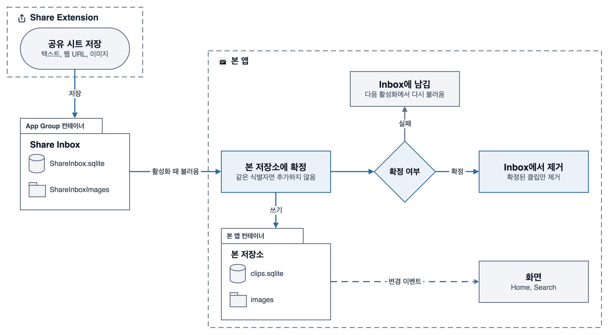

> **문제**<br>
> Share Extension과 본 앱은 별도 프로세스로 실행되며 같은 App Group 저장소에 접근함<br>
> 두 프로세스가 같은 SQLite 파일에 동시에 쓰면 잠금 충돌로 쓰기가 실패할 수 있음<br>
> 본 앱의 이미지 정리가 Extension이 저장 중이라 아직 참조되지 않은 파일을 지울 수 있음
>
> **해결**<br>
> 본 저장소는 본 앱만 쓰고 Extension은 App Group 컨테이너의 Inbox(SQLite와 이미지 폴더)에만 쓰도록 쓰기 주체를 분리<br>
> 앱이 활성화되면 Inbox의 클립을 본 저장소에 확정한 뒤에만 Inbox에서 제거<br>
> Inbox 이미지의 저장과 정리 복구는 Extension만 실행하고 본 앱은 읽기와 삭제만 수행
>
> **성과**<br>
> ✅ 본 저장소에 **두 프로세스가 동시에 쓰지 않는 구조**<br>
> ✅ 같은 식별자는 다시 추가하지 않아 **여러 번 불러와도 결과가 같음**<br>
> ✅ 불러오는 중 실패하거나 앱이 종료되어도 **클립 유실과 중복 없음**<br>
> ⚠️ 공유한 클립은 **본 앱이 활성화될 때** 기록에 반영

```swift
let copied = try await copy(clip, inboxImages: inboxImages)    // 본 저장소에 먼저 확정
try await remove(clip, inbox: inbox, inboxImages: inboxImages)  // 확정된 뒤에만 Inbox에서 제거
```

### **3. 정리 후보 기록으로 파일과 DB 불일치 복구**

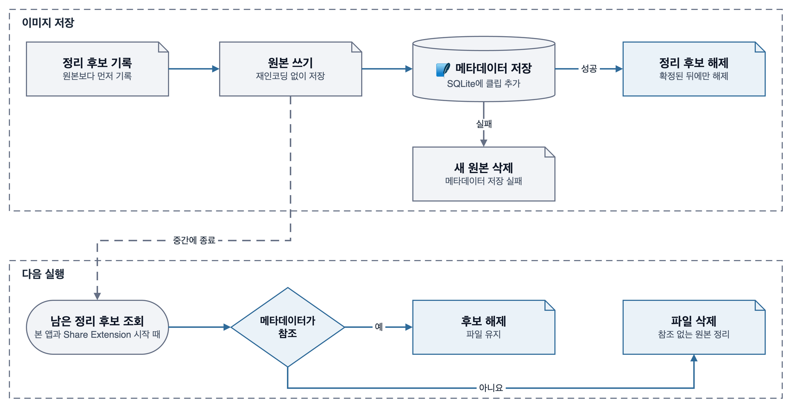

> **문제**<br>
> 이미지 원본은 파일로 저장하고 메타데이터는 SQLite로 저장하므로 하나의 트랜잭션으로 묶을 수 없음<br>
> 중간에 종료되면 참조 없는 파일이나 파일 없는 클립이 생길 수 있음
>
> **해결**<br>
> 원본을 쓰기 전에 정리 후보로 기록하고 메타데이터가 확정된 뒤에만 정리 후보를 해제<br>
> 다음 실행 때 남은 정리 후보 중 메타데이터가 참조하는 파일은 남기고 나머지를 정리
>
> **성과**<br>
> ✅ 어느 단계에서 중단되어도 **참조 없는 파일 없이 복구**<br>
> ⚠️ 중단으로 인해 남은 파일은 **다음 실행의 복구 전까지** 디스크에 남음

```swift
let image = try files.save(data)                // 정리 후보 기록 후 원본 저장
try await storage.insert(clip)                  // 실패하면 새 원본 정리
try files.finishPending(fileID: image.fileID)   // 확정된 뒤에만 정리 후보 해제
```

### **4. Sendable 제한과 MainActor 격리로 `@unchecked Sendable` 없이 Swift 6 언어 모드 전환**
> **문제**<br>
> ReactorKit과 RxSwift, `NSItemProvider`처럼 `Sendable`을 보장하지 않는 API에서 데이터 경합 진단 발생<br>
> `@unchecked Sendable`로 진단을 끄면 이후 생기는 경합을 컴파일러가 잡지 못함
>
> **해결**<br>
> Reactor의 `Action`, `Mutation`, `State`를 `Sendable`로 제한하고 비동기 결과는 `@Sendable` 클로저로만 RxSwift 스트림에 연결<br>
> `NSItemProvider`는 래퍼 없이 `@MainActor`에 격리하고 콜백이 중복 호출될 수 있는 로드는 `OSAllocatedUnfairLock`으로 continuation을 한 번만 재개
>
> **성과**<br>
> ✅ 앱과 Share Extension, Widget, 테스트 타깃 **전체를 Swift 6 언어 모드로 전환**<br>
> ✅ 앱 코드의 `@unchecked Sendable`, `nonisolated(unsafe)` **0건**<br>
> ⚠️ 테스트의 `URLProtocol` 스텁 1곳은 **`@unchecked Sendable` 사용**

```swift
@MainActor
final class ClipShareItem {
    let providers: [NSItemProvider]    // Sendable이 아닌 값은 MainActor 안에서만 접근
    nonisolated let title: String?
}
```

### **5. 테스트 산출물 재사용으로 PR CI 시간 14.6분 → 8.4분 단축**
> **문제**<br>
> PR마다 `Build` 잡과 `Test` 잡이 macOS 러너에서 앱을 각각 컴파일함<br>
> 같은 PR에 다시 푸시해도 앞 실행이 끝까지 돌아 러너를 차지함<br>
> 테스트 시뮬레이터가 쓰지 않는 시스템 서비스까지 띄워 부팅이 느림
>
> **해결**<br>
> `Build` 잡이 한 번 컴파일한 테스트 산출물을 아티팩트로 넘기고 `Test` 잡은 테스트만 실행<br>
> 같은 PR의 진행 중인 앞 실행은 취소<br>
> 시뮬레이터 빌드에서 `x86_64` 제외<br>
> `develop`이 만든 패키지와 컴파일 캐시를 PR에서 재사용<br>
> 문서만 바뀐 PR은 `SwiftLint`, `Build`, `Test` 잡을 생략<br>
> 테스트 시뮬레이터는 simslim으로 쓰지 않는 시스템 서비스를 끄고 부팅
>
> **성과**<br>
> ✅ PR CI 실행 시간 **14.6분 → 8.4분**<br>
> ✅ `Test` 잡 실행 시간 **14.6분 → 3.0분**<br>
> ✅ 문서만 바뀐 PR은 **macOS 러너를 쓰지 않음**<br>
> ⚠️ 변경 후 기록은 **2회**이고 `develop` 컴파일 캐시가 쌓이기 전 실행

```yaml
concurrency:
  group: ${{ github.workflow }}-${{ github.event.pull_request.number || github.ref }}
  cancel-in-progress: true                                # 같은 PR의 앞 실행 취소

test:
  needs: [changes, build]                                 # Build가 올린 테스트 산출물을 내려받아
  # ...
  run: make test-prebuilt XCODEBUILD_FLAGS="-parallel-testing-enabled NO"  # 컴파일 없이 테스트만 실행
```

| 측정 조건 | 값 |
|:---:|:---:|
| 대상 | GitHub Actions `iOS CI` 워크플로우의 PR 실행 기록 |
| 변경 전 | 변경 직전 PR 실행 4회 |
| 변경 후 | 변경 PR의 실행 2회 |
| 지표 | 실행 시작부터 종료까지 걸린 시간의 중앙값 |

---

## 앱 아키텍처

- 화면은 `Feature`의 Reactor가 `Service`를 호출하고 저장소의 변경 이벤트로 갱신
- 저장소, 이미지 파일, 공유 저장 규칙은 `Plyst/Common`에 두어 본 앱과 확장 타깃이 같은 소스를 컴파일
- 클립 기록은 본 앱만 쓰고 확장 타깃은 App Group Inbox나 `plyst://` 링크로만 전달

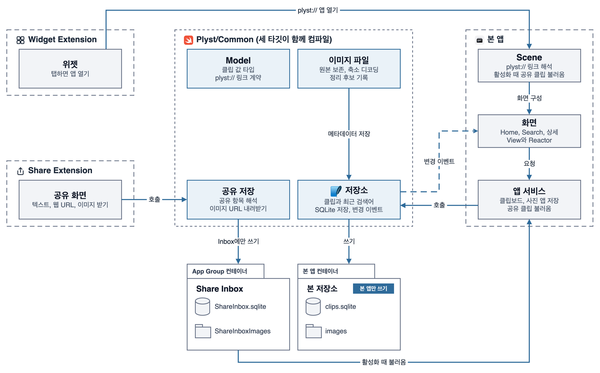

## 기술 스택

| 구분 | 스택 |
| --- | --- |
| 최소 지원 버전 | iOS 17.0+ |
| 지원 기기 | iPhone |
| 언어 | Swift 6.0 |
| 화면 | UIKit |
| 앱 확장 | Share Extension, Widget Extension |
| 상태 관리 | ReactorKit 3.2.0, RxSwift 6.10.2 |
| 비동기와 스트림 | async/await, `AsyncStream`(저장소 변경 이벤트), `AsyncThrowingStream`(`ReactorEffect`로 RxSwift에 연결) |
| 프로세스 간 데이터 전달 | App Group 컨테이너(공유 SQLite Inbox와 이미지 폴더), 커스텀 URL 스킴 `plyst://`(위젯에서 앱 실행) |
| 네트워크 | URLSession 임시 세션(이미지 URL 내려받기) |
| 저장소 | SQLiteData 1.12.0, GRDB 7.11.1, swift-structured-queries 0.39.2 |
| Apple 프레임워크 | UIKit, Foundation, WidgetKit, SwiftUI, ImageIO, Photos |
| 테스트 | XCTest |
| 자동화 | GitHub Actions, fastlane |
